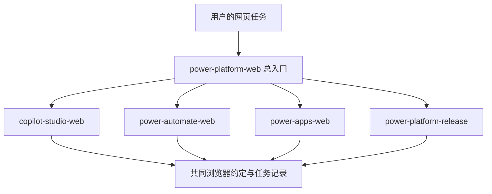

# 为什么采用 skill 套件

## 结论

采用 **5 个 skill 的套件**。由一个总入口协调，三个产品 skill 执行网页操作，一个发布 skill 处理跨环境交付。

这是本项目的设计判断。微软文档没有规定 agent skill 应如何拆分。判断依据是产品边界、跨产品依赖和独立验证需求。

## 方案比较

| 方案 | 适用情况 | 本需求中的问题 |
|---|---|---|
| 一个 skill，详细流程放 references | 只操作 Copilot Studio，跨产品步骤很少 | Power Apps 与 flow 独立任务难以准确触发，发布规则也容易混进普通编辑 |
| 每个按钮或功能一个 skill | 少量完全独立的动作 | 数量过多，选择容易冲突，共同约束重复 |
| 一个入口 + 产品 skill + 发布 skill | 多产品配置与端到端交付 | 需要完整安装套件并维护跨文件链接；本项目用校验与统一交付解决 |

套件不要求每次读完所有文件。单产品请求直接进入对应 skill。跨产品请求由总入口路由。微软的实施指南按规划、实施、管理和持续改进组织生命周期，实施部分也分别覆盖主题、工具、编排与渠道。见 [实施指导](https://learn.microsoft.com/en-us/microsoft-copilot-studio/guidance/overview) 和 [实施内容索引](https://learn.microsoft.com/en-us/microsoft-copilot-studio/guidance/implement-overview)。

## 结构与依赖

| 模块 | 负责 | 不负责 |
|---|---|---|
| power-platform-web | 路由、浏览器规则、任务状态、集成边界 | 重复每个产品的操作手册 |
| copilot-studio-web | agent 制作、配置、测试、本环境渠道发布 | GitHub Copilot SDK 开发 |
| power-automate-web | 云端 flow、agent flow 集成、连接、运行排障 | Desktop flow 的桌面录制与机器配置 |
| power-apps-web | Canvas、Model-driven 应用、数据与发布共享 | Power Pages 网站建设 |
| power-platform-release | Solution、依赖、环境迁移、管道与恢复 | 未授权的生产变更、租户全面治理 |

“发布到本环境渠道”留在产品 skill。“把一组组件迁移到另一环境”进入发布 skill。发布 skill 调用产品的验证流程，不复制整份手册。

## 三个关键设计

**用状态验证网页操作。** 手册描述可见页面锚点、输入和预期状态，不固定屏幕坐标。界面变化时按当前工具说明重新定位。此方法是套件设计；尚未以真实租户测量成功率。

**把共享约束放在一处。** 所有 skill 共用浏览器约定、身份边界和任务记录。五个目录必须同级安装。仅复制其中一个目录不属于支持的交付方式。

**只读必要文档。** skill 入口保留判断与路由；详细手册放 references；研究证据放 docs/research。运行时手册直接含官方链接，不依赖安装研究资料。

## 支持扩展

当前将 SharePoint、Teams、Entra、Dataverse 作为集成边界。只有出现反复、独立且可验收的管理任务时，再添加对应产品 skill。Microsoft 365 管理、Azure 资源部署、Power Pages 和 Dynamics 365 全产品管理不在本次覆盖承诺中。

微软建议选择适合实际任务的自动化工具并把自动化纳入测试与维护。该建议支持先交付可验证的有限流程，而不是一次涵盖所有微软产品。见 [自动化建议](https://learn.microsoft.com/en-us/power-platform/well-architected/operational-excellence/automate-tasks)。
